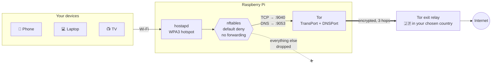

<h1 align="center">🛂 pi-passport</h1>

<p align="center">
  <b>Pick a country. Everything on your Wi-Fi appears to be there.</b><br>
  A Raspberry Pi hotspot that sends every connected device through Tor and out of the country you choose.<br>
  Free. No accounts, no sign-ups, no subscriptions, no apps on your devices.
</p>

<p align="center">
  <a href="../../actions/workflows/ci.yml"></a>
  
  
  
</p>

```console
$ sudo passport set japan
Exit country set to 🇯🇵 Japan (jp)
Checking the new exit…
✔ The web now sees 185.xxx.xxx.xxx, in 🇯🇵 Japan

$ sudo passport doctor
  ✔ pi-passport-firewall.service is running
  ✔ IPv4 forwarding is off (no route around Tor)
  ✔ firewall loaded, forward policy is drop
  ✔ SSH refuses passwords
  ✔ Tor is connected
  …
All checks passed.
```
<sub>Example output. Real IPs change every time.</sub>

---

## How it works



1. The Pi gets online over your normal Wi-Fi (or Ethernet), like any device.
2. A second radio (a cheap USB Wi-Fi adapter) broadcasts the **pi-passport** hotspot.
3. The firewall hands every TCP connection and DNS lookup from the hotspot to Tor and drops everything else.
4. Tor sends the traffic through three volunteer relays and out of an **exit relay in the country you picked**.

## Security design

The goal is to give an attacker very little to work with, and to **fail closed**: if anything breaks, traffic stops instead of leaking.

| Layer | What it does | Why it matters |
|---|---|---|
| **No routing at all** | `ip_forward=0` and the firewall's forward chain drops everything. The Pi never passes a client packet along. Tor is the only path out. | **A kill switch by design.** If Tor crashes, devices lose connectivity and nothing goes out unprotected. No "VPN dropped and I leaked" moment is possible. |
| **Strict exit country** | `ExitNodes {cc}` + `StrictNodes 1` | If no exit is available in your country, connections fail instead of quietly using another country. |
| **DNS through Tor** | Every DNS query on UDP 53, to any server, is redirected to Tor's resolver. | No DNS leaks, even from devices with hard-coded DNS like `8.8.8.8`. |
| **IPv6 off on the hotspot** | Disabled on the hotspot interface and dropped by the firewall. | Closes the most common VPN leak. |
| **Firewall before network** | The `nftables` ruleset loads before *any* interface comes up (`network-pre.target`). | There's no window during boot when the Pi is exposed. |
| **Hotspot exposes 3 ports** | DHCP, Tor DNS and Tor TransPort only. SSH, the control port and everything else are unreachable from the hotspot. | A malicious device on the hotspot can't touch the Pi's admin surface. |
| **Client isolation** | `ap_isolate=1` + each device gets its own Tor circuits (`IsolateClientAddr`). | Devices can't see each other, and they can't be linked by a shared exit. |
| **Home LAN unreachable** | Nothing is routed, and Tor refuses private addresses. | Guests on the hotspot can't reach your router, NAS or printer. |
| **WPA3-SAE + PMF** | Protected management frames required, random 24-char password, hourly group rekey. | Resists offline password cracking and deauth attacks. Falls back to WPA2/WPA3 only if your adapter can't do WPA3. |
| **SSH locked down** | Keys only, no root, one allowed user, rate-limited, never on the hotspot side. | Applied automatically once you've added an SSH key. |
| **No web dashboard** | Everything is done with a CLI over SSH. | A web admin panel is one of the most common ways routers get hacked. This one doesn't have one. |
| **Tor control by socket + cookie** | The control port is a root-only Unix socket. There's no TCP control port. | Nothing on any network can reconfigure Tor. |
| **Kernel hardening** | `rp_filter`, no redirects or source routing, `kptr_restrict`, `ptrace_scope=2`, BPF hardening… | Standard hardening for a network appliance. |
| **Auto-updates** | `unattended-upgrades` installs Debian security fixes daily. | Most real-world compromises exploit known, already-patched bugs. |
| **Minimal code** | The CLI uses only the Python standard library. Configs are plain and readable. | Less code and fewer dependencies mean fewer places for bugs to hide. |

Check all of it any time with `sudo passport doctor`.

## What you need

- **Raspberry Pi 3, 4, 5 or Zero 2 W** running **Raspberry Pi OS Lite (Bookworm or newer)**
- **One of these:**
  - a **USB Wi-Fi adapter that supports AP mode**, about $10–15 (e.g. based on MT7601U, MT7612U, RT5370 or RTL8188EUS chips). This lets the Pi stay on your home Wi-Fi with no cables.
  - **or** an Ethernet cable. The Pi's built-in Wi-Fi then broadcasts the hotspot (WPA2/WPA3 mode).

That's it. No VPN subscription, no account, no payment.

## Install

1. Flash **Raspberry Pi OS Lite** with [Raspberry Pi Imager](https://www.raspberrypi.com/software/). In its settings, enter your Wi-Fi and **enable SSH**.
2. Plug in the USB Wi-Fi adapter, boot, and from your computer:

```bash
ssh-copy-id you@raspberrypi.local
```

```bash
ssh you@raspberrypi.local
```

3. On the Pi:

```bash
sudo apt-get install -y git && git clone https://github.com/NoamAdept/pi-passport.git && cd pi-passport
```

```bash
sudo ./install.sh --country japan
```

The installer prints the hotspot password and a **QR code**. Scan it with your phone and you're connected through Japan.

<details>
<summary>Installer options</summary>

```text
--country CODE       Exit country: jp, de, "Japan", or "any" (default: any)
--ssid NAME          Hotspot name (default: Passport)
--ap-if IFACE        Radio for the hotspot (default: auto-detect)
--wifi-region CC     Where the Pi physically is, for legal radio channels
--channel N          2.4 GHz channel 1-13 (default: 6)
--security MODE      wpa3 (default) or wpa2-wpa3 for older devices
--new-passphrase     Generate a fresh hotspot password
```
Re-running the installer is safe. It updates the config in place.
</details>

## Usage

| Command | What it does |
|---|---|
| `sudo passport set <country>` | Switch countries: `jp`, `Germany`, `uk`, `"united states"`, or `any` for the fastest exits |
| `sudo passport status --check` | Shows the configured country, your live circuits, and what the web actually sees |
| `sudo passport list` | Countries with Tor exits available **right now**, and how many |
| `sudo passport new` | Get a fresh IP in the same country |
| `sudo passport wifi` | Show the hotspot name, password and QR code |
| `sudo passport doctor` | Run the security self-check |

Bonus: `.onion` sites work in **any** browser on the hotspot, not just Tor Browser.

## Threat model: what this does and doesn't protect

**Protects against**
- ✅ Your ISP, school or hotel network seeing which sites you visit
- ✅ Websites learning your real IP address and location
- ✅ DNS, IPv6 and "VPN dropped" leaks, for *every* device on the hotspot, including ones that can't run a VPN app
- ✅ Devices on the hotspot attacking each other, the Pi, or your home network

**Does not protect against**
- ❌ **You identifying yourself.** If you log in to Google or Instagram, they know who you are, whatever country you appear to be in.
- ❌ **Snooping on unencrypted sites.** The exit relay can see plain `http://` traffic. Stick to `https://` (nearly everything is today).
- ❌ **Browser fingerprinting.** For serious anonymity, use [Tor Browser](https://www.torproject.org/). pi-passport is about *location* and *network privacy*.
- ❌ **A compromised device.** Malware on your phone stays malware.

No system is "unhackable". This one is built to keep the attack surface as small as possible and to fail closed. See [SECURITY.md](SECURITY.md).

## Why Tor and not a VPN?

| | pi-passport (Tor) | Free VPN services | Paid VPN |
|---|---|---|---|
| Cost | **Free** | Free | $5–12/month |
| Account / sign-up | **None** | Email or account required | Account + payment |
| Choose any country | ✅ ~50+ with exits | Usually 1–5 | ✅ |
| Who can see your traffic | **No single party sees both you and the site** | The VPN company | The VPN company |
| Speed | Moderate | Varies | Fast |
| Streaming sites | Often blocked | Often blocked | Usually works |

Tor is the only option that meets all three requirements: **free, no accounts, any country**. It also needs no trust in a company.

## Limitations

- **Speed.** Expect roughly 5–30 Mbit/s and higher latency: fine for browsing and video, not for gaming.
- **TCP only.** UDP is dropped, apart from DNS. Browsers fall back from QUIC automatically, but voice and video calls in some apps and online games won't work.
- **Some sites block Tor** or show extra CAPTCHAs. Many streaming services refuse Tor exits.
- **Country choice depends on volunteers.** Run `sudo passport list` to see where exits exist today.
- Make sure using Tor is legal where you are. It is in most countries.

## Uninstall

```bash
sudo ./uninstall.sh
```
Add `--all` to remove the SSH and kernel hardening too.

## Project layout

```text
install.sh              idempotent installer (detects radios, renders templates)
uninstall.sh            restores previous configs
src/passport.py         the `passport` CLI (stdlib only; speaks Tor's control protocol)
templates/
  firewall.nft          the nftables ruleset: the heart of the leak protection
  torrc                 Tor as a transparent proxy with strict exit country
  hostapd.conf          WPA3 hotspot with client isolation
  dnsmasq.conf          DHCP only (DNS goes to Tor)
  sysctl.conf           kernel hardening, forwarding off
  sshd.conf             key-only SSH
  *.service             systemd ordering: firewall → interface → Tor/hostapd
tests/                  unit tests incl. a fake Tor control server
.github/workflows/      ShellCheck, Ruff, tests, and an nft syntax check of the firewall
```

## License

[MIT](LICENSE). Tor is a trademark of The Tor Project, Inc. This project is not affiliated with The Tor Project.
